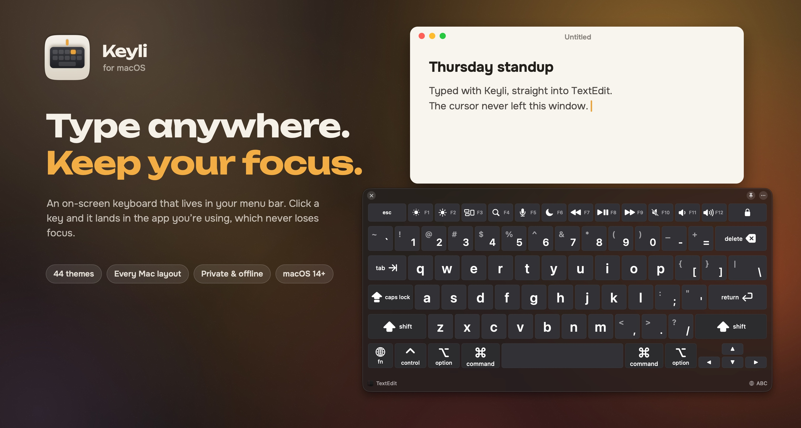
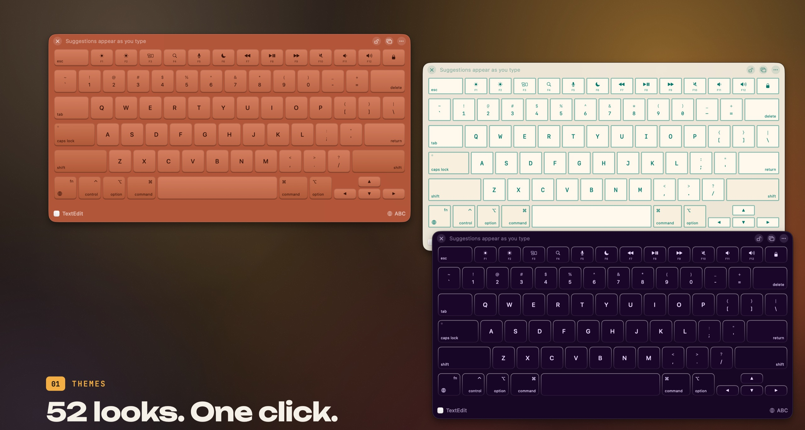
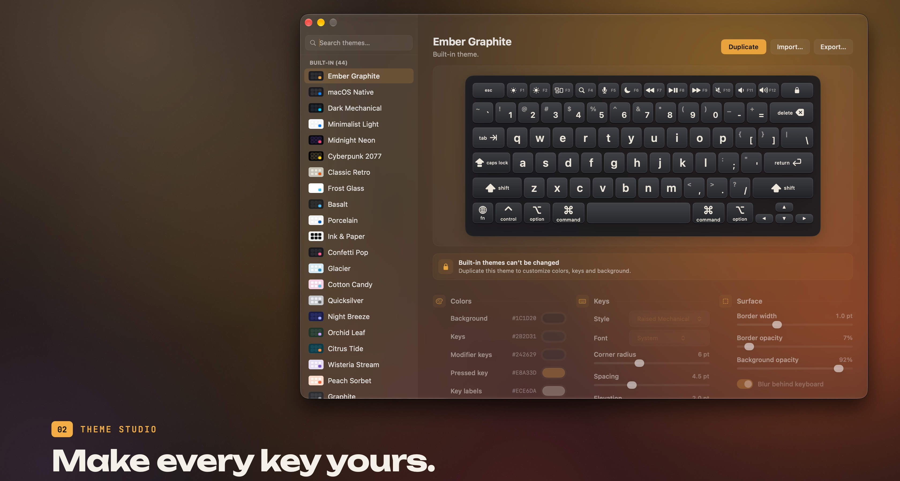
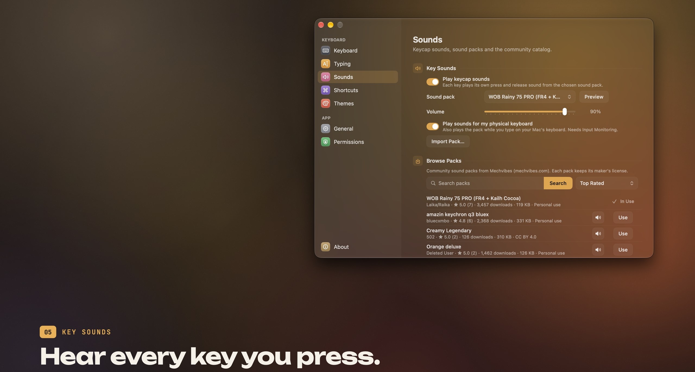
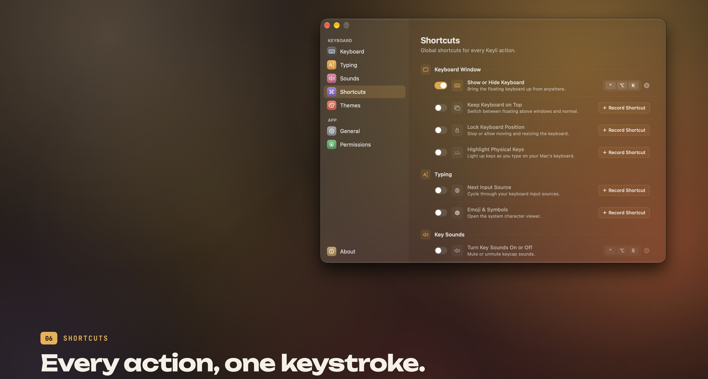

  

<h1 align="center">Keyli for macOS</h1>

  An on-screen keyboard for your menu bar. Click keys to type into any app, without taking its focus.

  
  
  
  

  

---

  

## Features

- Type into the app you're using by clicking keys. Keyli never steals its focus.
- Shift, Option, Control and Command work for the next key. Double-click or hold one to lock it, like holding it down on a real keyboard, then click it again to unlock.
- Tap fn to do what your Globe key does, such as switching input source. Hold fn to latch it for F1–F12, Home, End and Page Up/Down.
- Function row works like a Mac: brightness, Mission Control, Spotlight, media, volume and lock. Latch fn for F1–F12.
- Hold a key to repeat it at your system key-repeat speed.
- Labels follow your input source live, including Shift and Option characters. Switch input source from Settings or the menu bar.
- ANSI, ISO, JIS and compact layouts that resize in proportion and never stretch, with an optional numeric keypad.
- Hold a letter for accents like é, ñ and ü, or swipe across letters to type a whole word.
- With ⌘ or ⌃ on, keys show what they do in the app you're using, read from its menus.
- Optionally light up keys you press on your physical keyboard. Nothing is recorded or stored.
- **Lock Physical Keyboard** from the menu bar (or a shortcut) ignores your Mac's physical keyboard, modifiers and media keys while keeping mouse clicks and on-screen typing working.
- Keycap sounds with press and release sounds per key, on the on-screen keyboard and optionally your Mac's keyboard (even in Secure Input fields), plus an audio keep-alive to prevent Bluetooth speaker latency. Seven packs are built in, and you can browse and install community packs.
- Pitch and loudness vary slightly on every press, **Quiet Times** mutes sounds during calls and in apps you choose, and you can star favorite packs and set a separate physical keyboard volume.
- Show keystrokes on screen for screencasts, press keys by hovering, get word suggestions that learn your words and predict the next one, and add one-click snippet keys that type a phrase or send a shortcut.
- Clipboard history keeps your recent copies, in memory only, ready to paste with a click from `⋯ › Clipboard History…`.
- Export and import all your settings, or sync them between Macs through iCloud Drive or any synced folder.
- Remap any key to type text, press another key, send a shortcut, run a snippet or disable it, or switch the letters to Dvorak or Colemak.
- VoiceOver reads every key, its state and its accents.
- The keyboard can show itself when you click into a text field and hide again afterwards.
- Global shortcuts for every Keyli action: show the keyboard, keep on top, lock position, lock physical keyboard, numeric keypad, key highlighting, keystroke overlay, snippets, clipboard history, word suggestions, sticky modifiers, input source, Emoji & Symbols, key sounds, themes and more.
- The menu bar icon shows your input source and lists your input sources, Emoji & Symbols, **Lock Physical Keyboard**, assigned shortcuts and Settings. ⌥-click it to show or hide the keyboard.
- Keep on Top keeps the keyboard above other windows. Lock Position stops it from being moved or resized.

  

## Themes

52 built-in themes, from macOS-native and mechanical looks to flat Windows-inspired styles, retro terminals, glass, and bolder palettes like Kiln, Riso Print, Blacklight and Mustard. Theme Studio lets you duplicate any theme and change its colors, key style, font, spacing, borders and background, then export or import it as JSON.

  

## Sounds

Turn on keycap sounds in **Settings › Sounds**. Every key plays its own press and release sound, overlapping sounds never cut each other off, and held keys don't repeat. Pick one of Keyli's two original built-in packs, Slate Thock and Quartz Tick, star favorites, adjust volume (with an optional separate volume for your Mac's keyboard), enable **Vary each key slightly**, or mute automatically during calls and in chosen apps with **Quiet Times**.

**Browse Packs** searches the community catalog at [mechvibes.com](https://mechvibes.com) and installs a pack in one click, with checksum verification. Keyli doesn't bundle any third-party packs: community packs are only installed from Mechvibes when you choose them, and each keeps its maker's license.

  

## Shortcuts

**Settings › Shortcuts** lists every action you can trigger from anywhere: show or hide the keyboard, keep on top, lock position, highlight physical keys, lock physical keyboard, numeric keypad, keystrokes on screen, snippets, clipboard history, word suggestions, sticky modifiers, input sources, Emoji & Symbols, key sounds, sound packs, volume steps, themes, Settings, Theme Studio, Setup Assistant, menu bar icon and update checks. Click a shortcut to record it; Keyli warns about conflicts, and enabled shortcuts also appear in the menu bar menu.

  

## Settings

Keyboard, Typing, Sounds, Shortcuts, Remap, Themes, General, Permissions and About, in one native window. **General** includes appearance style (Classic or Liquid Glass), login item, menu bar visibility, automatic updates, and **Backup & Sync**. **Permissions** shows live status and fixes common problems in place. Setup Assistant walks through typing, key lighting, sounds and login on first launch.

  

## Permissions

| Permission | Needed for | Required |
|---|---|---|
| Accessibility | Typing, Emoji & Symbols, function and media keys, Lock Physical Keyboard, auto-show, app shortcuts | Yes, to type |
| Input Monitoring | Highlighting keys, physical key sounds, keystroke overlay, learning typed words | No |
| Open at Login | Starting Keyli when you log in | No |

Viewing the keyboard needs no permission, and global shortcuts need none either. Keyli refuses to type into secure fields such as passwords.

## Install

Get the latest `.dmg` from [Releases](https://github.com/kiron0/keyli/releases/latest) and drag **Keyli** into Applications. Keyli isn't notarized by Apple, so the first time you open it, go to **System Settings › Privacy & Security** and click **Open Anyway**.

Keyli then updates itself from GitHub Releases (Settings › General).

## License

MIT. See [LICENSE](LICENSE). Want to help? See [CONTRIBUTING.md](CONTRIBUTING.md).
