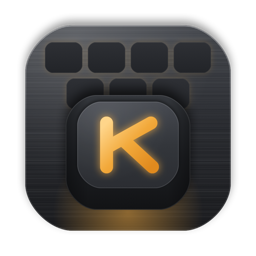
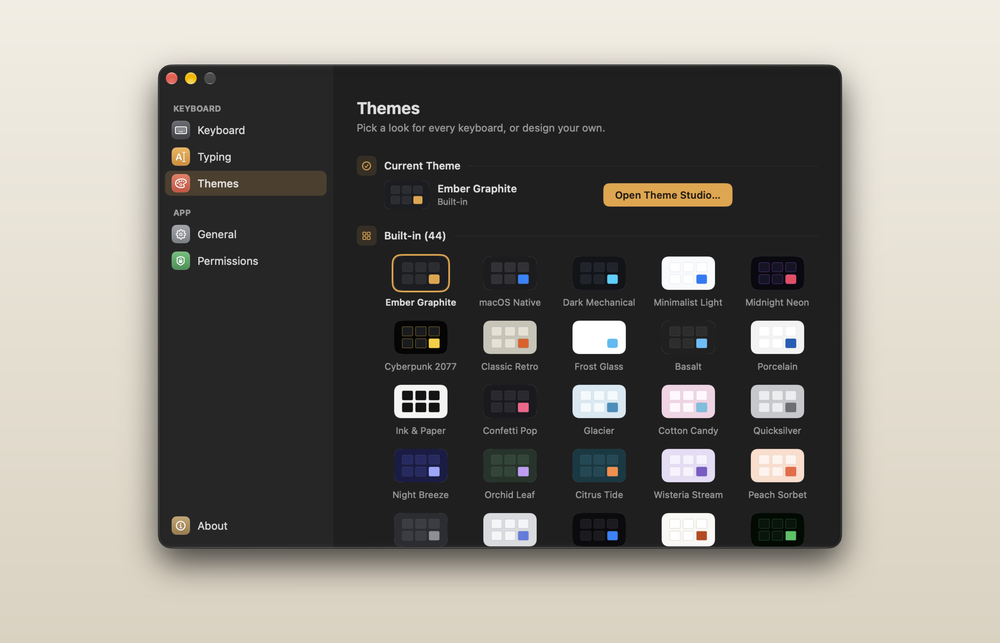

  

<h1 align="center">Keyli for macOS</h1>

  An on-screen keyboard for your menu bar. Click keys to type into any app, without taking its focus.

  
  
  
  

  

---

  

## Features

- Type into the app you're using by clicking keys. Keyli never steals its focus.
- Shift, Option, Control and Command latch for one key, or stay on until you tap them again.
- Tap fn to do what your Globe key does, such as switching input source. Hold fn to latch it for F1–F12, Home, End and Page Up/Down.
- Function row works like a Mac: brightness, Mission Control, Spotlight, media, volume and lock. Latch fn for F1–F12.
- Hold a key to repeat it at your system key-repeat speed.
- Labels follow your input source live, including Shift and Option characters. Switch input source from Settings.
- ANSI, ISO, JIS and compact layouts that resize in proportion and never stretch.
- Optionally light up keys you press on your physical keyboard. Nothing is recorded or stored.
- Click the menu bar icon to show or hide the keyboard. Pin it to keep it above other windows.

  

## Themes

44 built-in themes, from macOS-native and mechanical looks to flat Windows-inspired styles, retro terminals and glass. Theme Studio lets you duplicate any theme and change its colors, key style, font, spacing, borders and background, then export or import it as JSON.

  

## Settings

Keyboard window, typing behavior, themes, startup and permissions, in one native window. The Permissions page shows live status and fixes common problems in place.

  

## Permissions

| Permission | Needed for | Required |
|---|---|---|
| Accessibility | Typing, shortcuts, function and media keys | Yes, to type |
| Input Monitoring | Highlighting keys you press on the physical keyboard | No |
| Open at Login | Starting Keyli when you log in | No |

Viewing the keyboard needs no permission. Keyli refuses to type into secure fields such as passwords.

## Install

Get the latest `.dmg` from [Releases](https://github.com/kiron0/keyli/releases/latest) and drag **Keyli** into Applications. Keyli isn't notarized by Apple, so the first time you open it, go to **System Settings › Privacy & Security** and click **Open Anyway**.

## License

MIT. See [LICENSE](LICENSE). Want to help? See [CONTRIBUTING.md](CONTRIBUTING.md).
